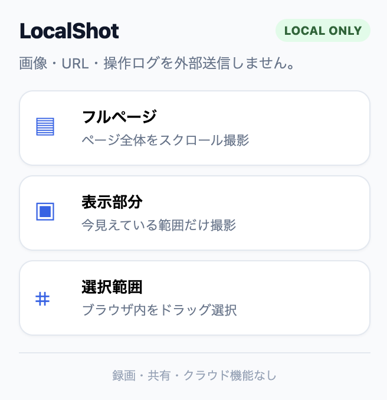
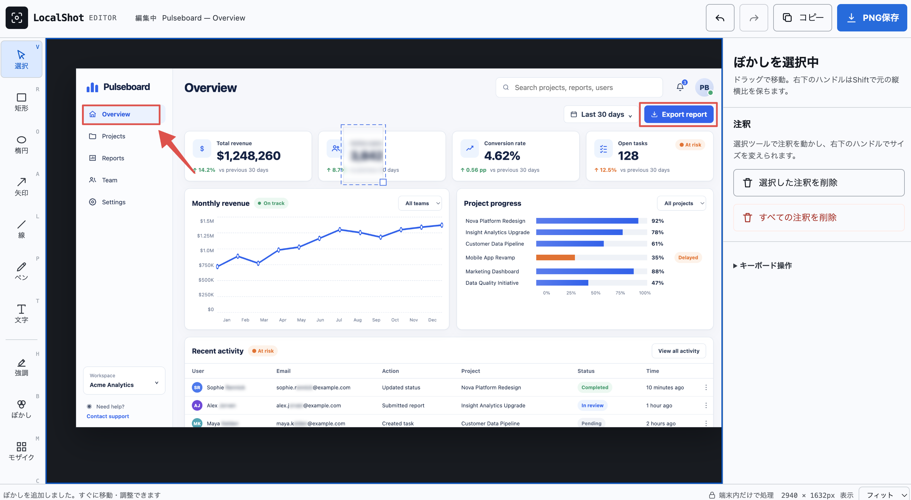

# LocalShot

完全ローカルで動作する、Chrome向けスクリーンショット・注釈拡張です。
撮影した画像はChrome内で処理し、クラウドや外部サーバーへ送信しません。

## できること

- フルページ撮影（scroll & stitch）
- 表示部分撮影
- ブラウザ表示領域内の選択範囲撮影
- 矩形、楕円、線、矢印、フリーハンド
- テキスト、ハイライト、ぼかし、モザイク
- クロップ
- 注釈の選択、移動、右下ハンドルでのリサイズ
- Undo / Redo
- PNGローカル保存
- 画像のクリップボードコピー
- キーボードショートカット

## プライバシーとセキュリティ

LocalShotは、撮影した画像、閲覧URL、注釈、操作ログを外部へ送信しません。

- サーバー、アカウント、広告、テレメトリ、クラウド保存なし
- 外部API、外部フォント、CDN、リモートJavaScriptなし
- `<all_urls>` ホスト権限、`debugger` 権限なし
- ManifestのCSPで `connect-src 'none'` を指定
- `npm run audit` でランタイムのネットワークAPIとリモートURLを検査

詳しくは [PRIVACY.md](./PRIVACY.md) と [SECURITY.md](./SECURITY.md) を参照してください。

### 権限

| 権限 | 用途 |
| --- | --- |
| `activeTab` | ユーザーが起動した現在タブへの一時アクセス |
| `scripting` | 範囲選択・スクロール制御などのオンデマンド注入 |
| `storage` / `unlimitedStorage` | 長いスクリーンショットのローカル一時保存 |
| `downloads` | PNG保存 |
| `clipboardWrite` | 画像のクリップボードコピー |

ホスト権限は宣言していません。

### 実装しない方針

- 録画
- クラウド保存、共有URL、アカウント
- 外部API通信、テレメトリ、アナリティクス
- 外部フォント、CDN、リモートJavaScript

## デモ

架空のSaaSダッシュボードを撮影し、編集画面で注釈を加えた例です。





## インストール

### 開発版を読み込む

1. このリポジトリをローカルにクローンする
2. Chromeで `chrome://extensions` を開く
3. 「デベロッパーモード」を有効にする
4. 「パッケージ化されていない拡張機能を読み込む」を選ぶ
5. このリポジトリのルートフォルダを選択する

ビルドは不要です。

### Chrome Web Store版

現在はソースから読み込む開発版を提供しています。Web Storeへの公開状況はリポジトリで案内します。

## 使い方

拡張機能のアイコンから以下を選びます。

- フルページ
- 表示部分
- 選択範囲

撮影後はLocalShot Editorが新しいタブで開きます。編集後に「PNG保存」または「コピー」を使用します。

### ショートカット

- `Alt+Shift+V`: 表示部分
- `Alt+Shift+F`: フルページ
- `Alt+Shift+S`: 選択範囲

Chrome側で競合する場合は `chrome://extensions/shortcuts` から変更してください。

## フルページ撮影の仕組み

1. ページまたは主要な内部スクロールコンテナを計測
2. ページ先頭を撮影
3. 2枚目以降はfixed / sticky要素を一時非表示
4. Chromeの撮影レート制限に配慮して順番にスクロール・撮影
5. Canvasでタイルを結合
6. DOM状態とスクロール位置を復元

内部スクロールコンテナ（SPAの中央ペイン等）も、主要なものをヒューリスティックに検出します。

## 既知の制限

- `chrome://` などの保護ページは撮影できません
- 極端に長いページはCanvasの安全上限により1枚へ結合できない場合があります
- Lazy Loadが非常に遅いサイトでは画像読み込みが間に合わない場合があります
- 複数の独立したスクロールペインを同時に「ページ全体」として撮影することはしません
- クロップは画像サイズを変更するため、クロップ直前状態のみ特別にUndo可能です

## 開発

```bash
npm run check
```

ネットワーク監査だけを実行する場合:

```bash
npm run audit
```

## コントリビューション

バグ報告、改善提案、Pull Requestを歓迎します。詳細は [CONTRIBUTING.md](./CONTRIBUTING.md) を参照してください。

設計判断と参考プロジェクトは [RESEARCH.md](./RESEARCH.md) に記録しています。

## ライセンス

MIT License。詳細は [LICENSE](./LICENSE) を参照してください。
